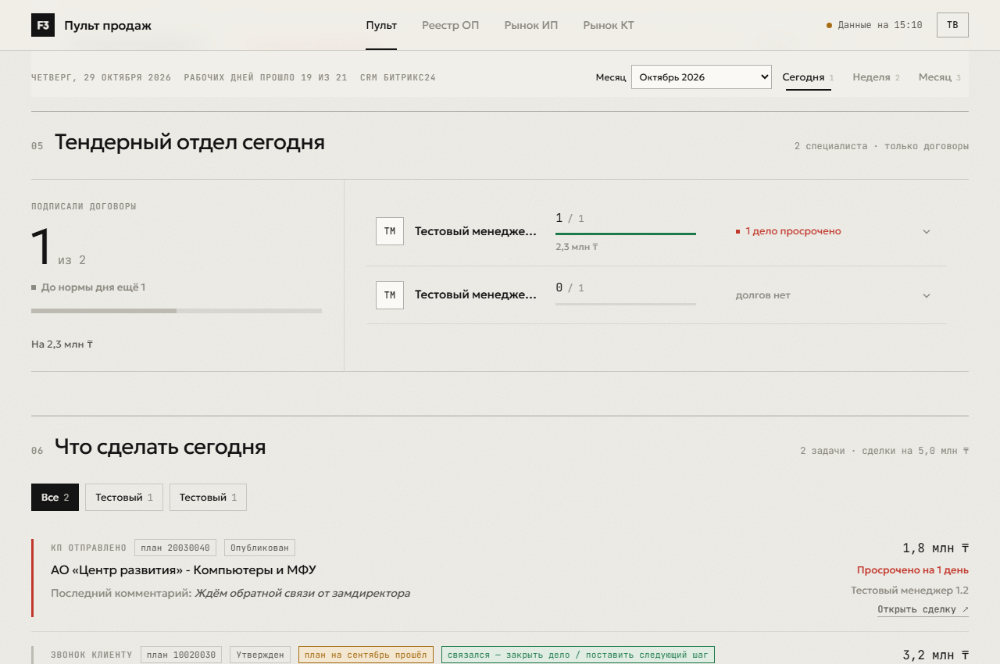
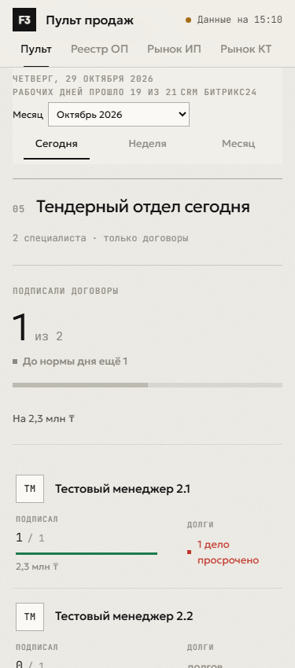
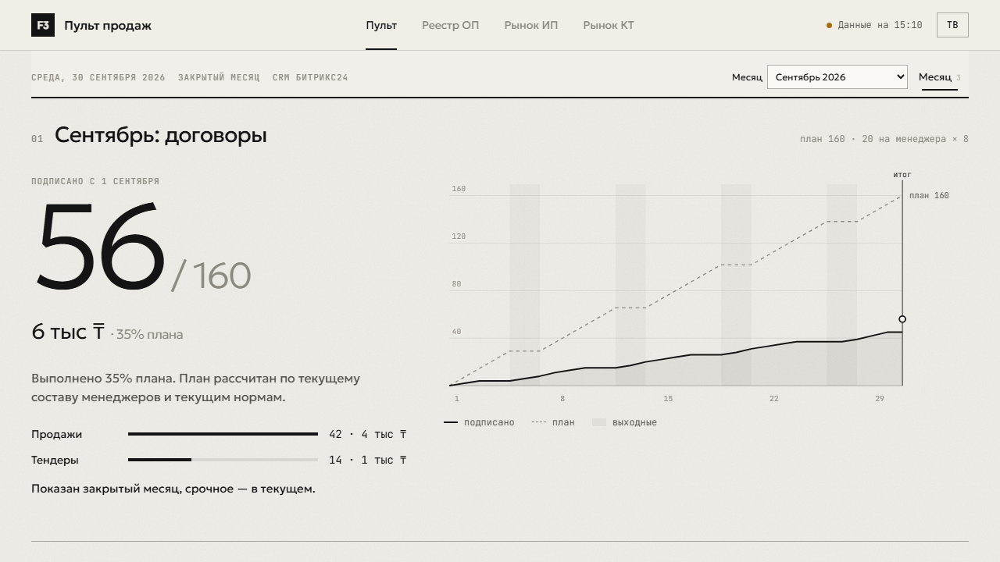

# Пульт: история месяцев и закреплённый период

Источник задачи: `exports/agent-tasks/2026-11-01-pult-months-and-sticky-periods.md`.
Сценарии и проверки выведены из этого задания.

## Сценарии

- Руководитель прокручивает до тендеров и переключает период на компьютере и телефоне.
- Открывает закрытый месяц по ссылке, видит итог против плана, без текущих срочных задач и прогноза.
- При недоступной истории продолжает работать с текущим месяцем.
- Обычный запуск использует ежедневный кэш истории, не повторяя запросы к CRM.

## RED / GREEN

1. `npx vitest run tests/bitrix/salesPultMonths.test.ts` — RED: модуль `months.js` отсутствовал, suite не загрузился.
2. `npx vitest run tests/bitrix/salesPultBrowser.test.ts -t 'keeps periods|opens and switches'` — RED: три проверки упали. Координаты переключателя после прокрутки: −2997 px (1280), −6248.625 px (375); ссылка на сентябрь открыла октябрь.
3. После реализации: `npx vitest run tests/bitrix/salesPultMonths.test.ts tests/automation/salesPultWorkflow.test.ts` — 2 файла, 8 тестов PASS.
4. Браузерные проверки после реализации — 3 PASS, 6 существующих тестов отфильтрованы. Проверяется положение полосы и заголовка, ссылка на месяц, изменение факта, скрытие текущих блоков, недоступный месяц, рынок после истории и возврат к текущему месяцу в ТВ.
5. Проверка недоступного `<option>` использует его DOM-свойство `disabled`: в установленном Playwright `isDisabled()` вернул false при наличии `disabled=""`.

## Решения

- `.dateline` закреплена под шапкой. ResizeObserver измеряет обе полосы; `scroll-margin-top` учитывает их суммарную высоту. Фон полосы непрозрачный. Старое grid-размещение `.periods` удалено.
- История собирается отдельно, по полным границам двух предыдущих месяцев. Текущий диапазон `getPultCollectionStartDate` сохранён, чтобы каждый запуск не забирал квартал.
- В историческом режиме сборщик не загружает текущие задачи и профили. Переходы стадий и звонки ограничены концом месяца. Ошибка истории не становится нулевым итогом: месяц получает null и недоступен в выборе.
- `data/pult-months` сохраняет готовые месяцы, дату обновления по Алматы и SHA-256 конфигурации. Кэш повторно используется в течение дня; смена конфигурации заставляет пересобрать историю. Ошибочный месяц пробуется снова при следующем запуске. Старые месячные файлы не попадают в payload после выхода за окно из трёх месяцев.
- Actions восстанавливает кэш по префиксу и сохраняет отдельный ключ каждого запуска.
- Истории состава команды и планов нет. Используются текущие нормы и активные менеджеры; это явно подписано под итогом закрытого месяца. Суммы и ответственные сделок также читаются в их текущем состоянии CRM.
- Скриншоты снимаются только с фикстурой и выдуманными именами, без данных боевого сбора.

## Спецификация тестов

| Гарантия | Проверка | Тип | Результат |
|---|---|---|---|
| Текущий и два прошлых месяца, в том числе через Новый год | salesPultMonths: includes two previous months | unit | PASS |
| Полный график закрытого месяца, итог против плана, без прогноза | salesPultMonths: completed month / final totals | unit | PASS |
| Границы исторических запросов, без текущих задач | salesPultMonths: bounds historical requests | integration, mock CRM | PASS |
| Дневной кэш, изоляция сбоя и смена конфигурации | salesPultMonths: caches / invalidates | unit, filesystem | PASS |
| Восстановление кэша до сбора | salesPultWorkflow | static workflow | PASS |
| Период виден на 1280/375, заголовок ниже полосы | salesPultBrowser: keeps periods | browser | PASS |
| Ссылка, переключение месяца, скрытые блоки, рынок и ТВ | salesPultBrowser: opens and switches | browser | PASS |

## Ограничения проверки

Боевые workflow, отправка в чат и деплой не запускались. Merge остаётся владельцу.

## Проверки перед PR

- `npm run lint` — PASS.
- `npm test` — `Test Files 144 passed | 3 skipped (147)`, `Tests 1653 passed | 9 skipped (1662)`, 46.84 с.
- `npm test -- --coverage --coverage.include=src/bitrix/salesPult/months.ts --coverage.include=src/bitrix/salesPult/view.ts --coverage.include=src/bitrix/salesPult/collect.ts` — те же 1653 PASS. Строки: months 100%, view 98.92%, collect 91.86%; ветви: 92.3%, 85.92%, 69.23% соответственно. Общие ветви этих модулей 76.67%; оставшиеся пробелы преимущественно в существующем сборщике. Отдельное покрытие клиентского JS не измерено; его поведение проверено браузером.
- `npm audit --omit=dev --audit-level=critical` — exit 0, найдено 11 существующих уязвимостей зависимостей (9 moderate, 2 high). Зависимости в этой задаче не менялись.
- `git diff --check` — PASS.
- Пропуски полного набора существующие: shell/retry сценарии и opt-in reportingDashboard E2E. Новые тесты не пропущены в полном запуске.

## Скриншоты на фикстурах

Дополнительный RED: закрытый октябрь с последним днём в выходной ставил линию итога на 30 вместо 31. Добавлены проверки `nowXDay = 31`, `dayFrac = 1`; для закрытого месяца конец графика теперь всегда конец последнего календарного дня.

## Время реального сбора

Последовательные локальные запуски `npm run bitrix:sales-pult -- --mode site` 1 ноября 2026 года; без `--execute`, без публикации. Базовая версия — origin/main 7406341 в отдельном worktree. Одинаковые зависимости и окружение, запросы CRM выполнялись последовательно. Все три команды завершились exit 0.

| Версия | Состояние кэша истории | Время |
|---|---|---|
| До изменения | Функции истории ещё нет | 71.10 с |
| После изменения | Кэша нет, собираются оба месяца | 183.67 с |
| После изменения | Оба месяца в дневном кэше | 70.78 с |

Это один локальный замер, а не статистика Actions: время зависит от сети и CRM. Повторный прогон с кэшем не стал заметно медленнее. Боевые логи, payload и кэш содержат приватные данные и оставлены только в игнорируемых локальных каталогах; в Git добавлены только скриншоты фикстур. Итоги контрактов и имена из CRM в отчёт не включены.

После исправления выходного дня: `npm run lint` PASS; `npm test` — 144 passed / 3 skipped files, 1653 passed / 9 skipped tests, 46.41 с. Финальный diff проверен перед push. RED-checkpoint a5667d9 сохраняется в ветке, GREEN зафиксирован следующим коммитом. Слияние не выполняется.
